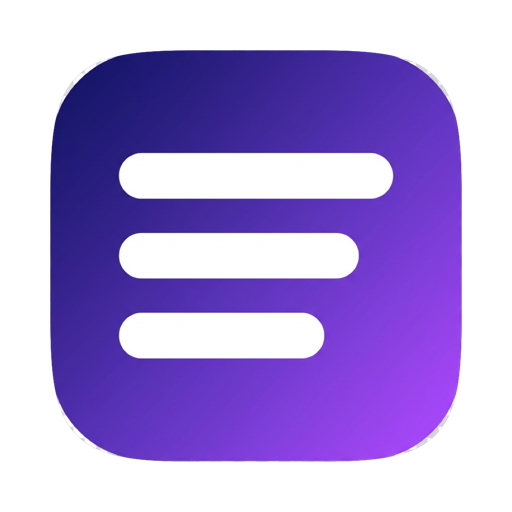
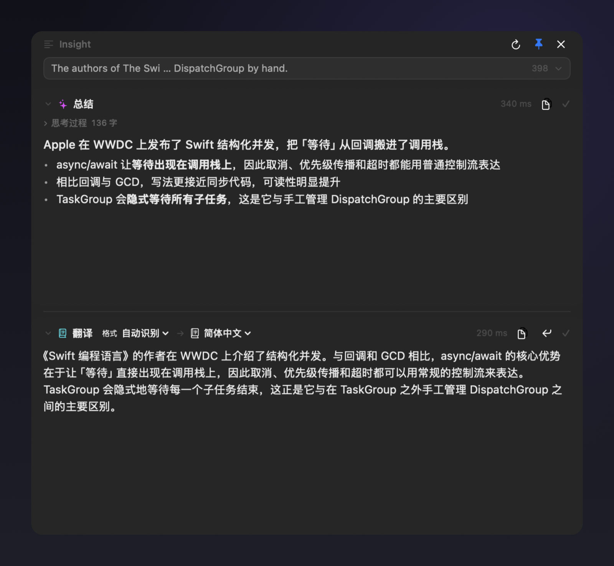

<div align="center">



# Insight

**macOS 菜单栏的划词 / 截图翻译与总结工具**

选中一段文字，或者框选一块屏幕 —— **总结和翻译在同一块面板里同时流式输出。**

[](LICENSE)


[](https://github.com/hsc113/Insight/releases/latest)

**[下载安装](#-安装) · [快速上手](#-快速上手) · [从源码构建](%EF%B8%8F-从源码构建)**



</div>

## ✨ 为什么是 Insight

我每天要读的东西里，「知道它说了什么」和「能把它讲清楚」往往是同一件事的两半。翻译做得好的工具很多，但**总结通常是个附加模式**：切过去、等它跑完、再切回来，想同时看两样就得开两次。

所以出发点很简单：**按下快捷键那一下，两件事一起开始做，结果显示在同一块面板上。** 一条链路慢或者失败，另一条照常出结果，不用选。

- **总结和翻译是两条独立链路，同时流式。** 不是「先翻译再总结」，也不是二选一，互不阻塞、互不影响。
- **也能只要其中一件。** 通用设置里选「仅翻译 / 仅总结 / 翻译与总结」—— 关掉的那一项在面板上缩成一行标题，把高度让给另一项，而不是留半个空框；关掉的那条链路根本不发请求。
- **窗口在按键那一刻就出现**，选区读取在后台进行，不用对着空屏等。
- **总结出来的是能直接用的 Markdown**：一句结论 + 要点 + 加粗重点。
- **弹窗可缩放、可置顶，位置和大小自动记住。** 两个卡片的高度能拖分割线单独分配 —— 长选文给译文留高度，转录稿给总结留高度。
- **提示词可改、可还原。** 总结一套、翻译一套，编辑框里能直接看到渲染后的真实请求；改坏了一键回到出厂版本，逐字节相同。
- **写回原文 `⌘⇧C`。** 只对文本框、文本区、搜索框写回，遇到其他控件会拒绝；剪贴板只是借用，用完还你。
- **数据全部留在本机。** 无遥测、无账号；密钥只存本机文件（权限 `0600`），截图 OCR 走系统 Vision 离线完成，用量统计也是本地的一个小文件。
- **原生 SwiftUI + AppKit**，没有 WebView、没有 Electron、没有 Rust 运行时，可执行文件 3.5 MB。

## 📦 安装

1. 前往 [**Releases**](https://github.com/hsc113/Insight/releases/latest) 下载 `Insight.zip`；
2. 解压，把 **Insight.app** 拖进「应用程序」文件夹；
3. 打开。第一次会碰到系统的「无法验证开发者」提示 —— 见下面的说明。

> [!WARNING]
> **应用尚未代码签名（ad-hoc 签名）。** 首次打开提示「无法验证开发者」时，两种办法任选其一：
>
> - 在「应用程序」文件夹里**右键 Insight → 打开**，再点一次「打开」（之后不会再问）；
> - 或在终端执行：
>   ```bash
>   xattr -dr com.apple.quarantine /Applications/Insight.app
>   ```
>
> 建议先核对下载文件的校验和，与 Release 页标注的 SHA256 对比：
>
> ```bash
> shasum -a 256 ~/Downloads/Insight.zip
> ```

> [!NOTE]
> 系统要求：**Apple 芯片 Mac + macOS 26 及以上。**

## 🚀 快速上手

### ① 授权两项系统权限

| 权限 | 用途 |
|---|---|
| **辅助功能** | 读取划词内容、注册全局快捷键 —— 没有它热键不会响应 |
| **屏幕录制** | 截图翻译的选区截图（授予后需要重启一次应用才生效） |

首次启动的引导页会带你完成这两步；之后随时可以在 **设置 › 通用 › 权限** 里查看状态。

### ② 配置一个模型（可选）

大模型负责**总结**和「复用大模型」的翻译，配置在 **设置 › 接口**：

| 服务商 | Key 申请地址 |
|---|---|
| DeepSeek | [platform.deepseek.com](https://platform.deepseek.com) |
| 智谱 GLM | [open.bigmodel.cn](https://open.bigmodel.cn) |
| 通义千问 | [阿里云百炼](https://bailian.console.aliyun.com) |
| 任意 OpenAI 兼容端点 | 自建或第三方均可，含本地 [Ollama](https://ollama.com)（`http://localhost:11434`）、LM Studio |

- 填好 Key 后点「**获取模型列表**」会自动滤掉 embedding / 图像 / 语音这类非对话模型；「**测试连接**」发一次真实请求并显示首字延迟。
- **不配 Key 也能用**：翻译引擎选「Apple 系统翻译」即可离线翻译。百度 / 腾讯 / DeepL 的翻译 Key 也在同一页配置（[DeepL API](https://www.deepl.com/pro-api)、[百度翻译开放平台](https://fanyi-api.baidu.com)、[腾讯云机器翻译](https://console.cloud.tencent.com/tmt)）。

### ③ 按下快捷键

- **划词翻译**：默认 `⌥D` —— 在任意应用选中文字，按热键
- **截图翻译**：默认 `⌥S` —— 框选屏幕区域，离线 OCR 识别后走同一块面板

快捷键可在 **设置 › 通用 › 快捷键** 里改；菜单栏图标可以随时单独开关总结和翻译。

## 🛠️ 从源码构建

只需要 Command Line Tools，不需要完整 Xcode：`xcode-select --install`

```bash
git clone https://github.com/hsc113/Insight.git
cd Insight
make build     # 产出 dist/Insight.app（ad-hoc 签名）
make install   # 构建并安装到 /Applications
make check     # 跑全部离线检查（500+ 项）
make demo      # 不用配 API Key 就能看界面
```

## 📄 许可

[MIT](LICENSE)。项目**零第三方依赖**，整个 app 只使用系统框架。
